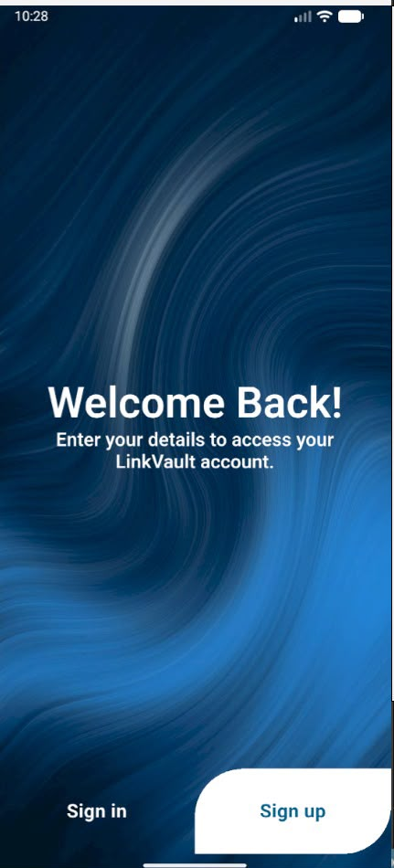
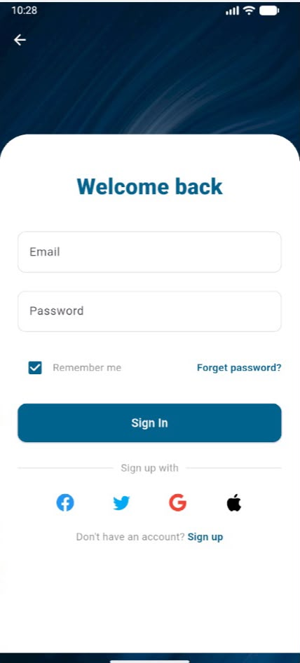
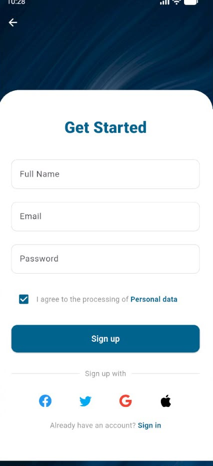
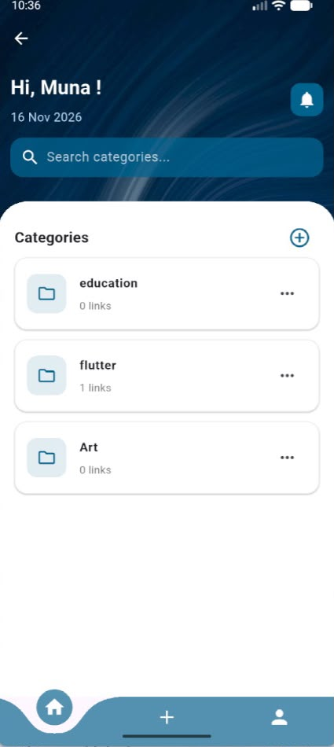
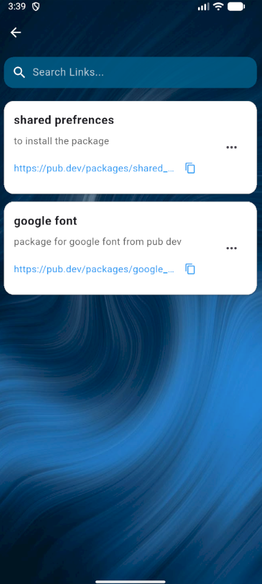
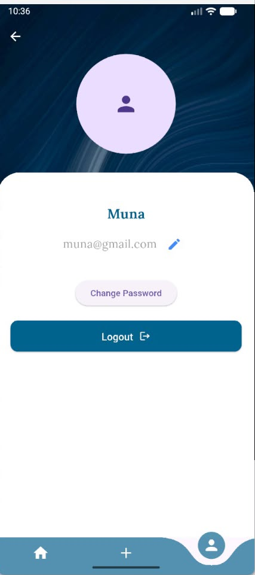
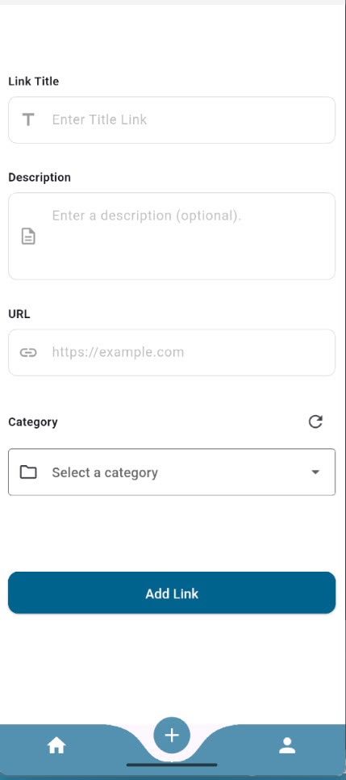
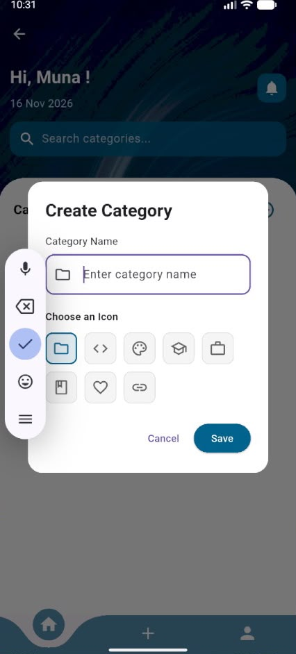

# LinkVault 🔗

A mobile application designed to help users manage and organize their links in one place.

LinkVault is built using **Flutter** for the mobile application and **Laravel** for the backend REST API.

## 📱 Project Preview

<!-- Add application preview image here -->

## ✨ Features

- User Authentication.
- User Registration and Login.
- Link Management.
- Integration with RESTful APIs.
- Backend communication using Laravel API.

## 🛠️ Technologies Used

### Frontend
- Flutter
- Dart

### Backend
- PHP
- Laravel
- REST API
- MySQL

### Tools
- Visual Studio Code
- Postman
- Git & GitHub

## 📸 Screenshots

### Welcome & Authentication

<p align="center">
  
  
  
</p>

### Main Application

<p align="center">
  
  
  
</p>

### Link Management

<p align="center">
  
  
</p>

## 🎥 Application Demo

<p align="center">
  
</p>

## ⚙️ Installation

1. Clone the repository:

   ```bash
   git clone https://github.com/Mona331/linkvault-app.git
   ```

2. Navigate to the project directory:

   ```bash
   cd linkvault-app
   ```

3. Install dependencies:

   ```bash
   flutter pub get
   ```

4. Run the application:

   ```bash
   flutter run
   ```

## 👩‍💻 Developer

**Muna Hussein**

GitHub: [Mona331](https://github.com/Mona331)

---

⭐ If you find this project interesting, feel free to explore the repository!
